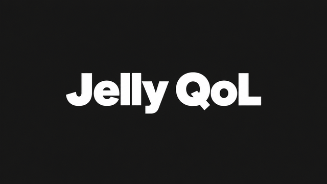

# Jelly QoL



Quality-of-life features for **Jellyfin 12.1**, with Polish and English controls. Formerly Media Hider; title restrictions, groups and reveal schedules are preserved.

## Install or update

Requires **[File Transformation](https://github.com/IAmParadox27/jellyfin-plugin-file-transformation)** for Jellyfin 12.1 (tested with 3.0.2.0 and 3.0.3.0). Add its repository if needed:

```text
https://www.iamparadox.dev/jellyfin/plugins/manifest.json
```

Add the Jelly QoL repository in **Dashboard → Plugins → Repositories**:

```text
https://raw.githubusercontent.com/Wardf1/JellyQoL/main/manifest.json
```

Install or update, restart Jellyfin, and reload the web client. If your Jellyfin installation still uses the previous repository address, replace it with the URL above. Plugin settings are preserved. For a server still running **Media Hider 1.3**, install **1.4** from the version selector and restart before upgrading further; 1.4 handles the name transition.

File Transformation adds the scripts in memory; web-directory write permissions are unnecessary. Custom controls require the server-hosted web client. Native and separately hosted clients do not receive injected scripts.

Open **Dashboard → Plugins → Jelly QoL** in the sidebar for direct access to the settings.

## Settings tabs

### Media Hider

Administrators can search, hide and restore movies and entire series, and configure optional user groups. Visibility status appears beside the year/rating; the native three-dot menu provides hide/restore controls. Season and episode actions apply to the parent series.

Without groups, hidden titles remain administrator-only. With groups, select all non-administrator accounts or specific groups. Membership in any targeted group blocks access; administrators retain access. Deleting the final targeted group makes a title administrator-only.

Each group has an independent, optional one-time reveal date and time. Dates use the browser's time zone and are stored in UTC. **Jelly QoL → Reveal scheduled group titles** checks once a minute. Only the due group's restrictions are removed; other groups and administrator-only rules remain. The date is cleared after completion. Overdue dates are processed after startup.

Server tags and Jellyfin parental controls enforce visibility across clients. Existing unrelated tags and restrictions are preserved. Lists may need refreshing; existing playback and downloads are unaffected. **Restore all hidden titles before uninstalling.**

### QoL

Each function can be enabled separately:

- **Active-filter warnings:** the filter icon blinks while Jellyfin's native indicator reports active filters. No extra text is added to the toolbar. Animation can be disabled; reduced-motion preferences are respected. Active filter labels and category counts update live, including collapsed categories.
- **Right-click title menu:** forwards right-clicks on media cards to the native menu. Shift + right-click retains access to the browser menu. Inputs and players are unaffected.
- **Search order:** Movies → Series → Discover on Seerr. Missing sections are not created, and empty result sections are hidden. Seerr results still require the integration that provides them.
- **Notification icons:** replaces supported missing icon placeholders in Jellyfin Enhanced toasts with local SVGs. Jellyfin Enhanced is optional.
- **Pagination:** adds synchronized top/bottom controls to paginated Modern library views, forwarding actions to Jellyfin's native controls.

### Services

Two configurable header shortcuts, each with its own **name and URL**. Empty addresses hide individual shortcuts. Links are hidden on login/setup pages and open in a new tab. HTTP/HTTPS addresses without embedded credentials are accepted; no personal addresses are built into the plugin.

### Announcements

An optional home-page announcement, disabled by default. Configure its title, message, bullet points, button label/URL, top/bottom position, start/end dates, automatic hide duration, appearance limit, cooldown, counter-reset period, session repeats and remembered dismissal. Dates use the browser's time zone and are stored in UTC. Zero disables an individual numeric limit as described beside each field.

Use **Test** to preview the current form values before saving. The preview works with a disabled announcement, ignores dates and limits, and does not update appearance counters or dismissal state. Only the current administrator sees it.

Counters and dismissal are separate for each account **in each browser**. A changed message starts a new announcement. Content is rendered as plain text; arbitrary HTML and scripts are unsupported. Scheduling, limits and expiry are checked while the web client is open.

QoL, Services and Announcements preferences apply server-wide and reach other open web clients within 30 seconds. Filter state comes from the active Jellyfin library view in that browser. Visibility/group settings and all settings changes require an administrator; configured service links and announcements are available only to authenticated accounts.

Requires .NET 10. Internal assembly, plugin ID, configuration file and API paths retain their original identifiers for compatibility. GPL-3.0-only. The catalog thumbnail was edited with built-in imagegen; see [its prompt](assets/jelly-qol-prompt.txt).
### Notifications

Optional server-wide notifications from **completed Seerr requests** and **new Jellyfin media**. Both sources and all media types are enabled by default in user preferences; an administrator first enables collection in the **Notifications** tab. Collection starts at activation, without sending the existing library. New accounts receive future events only.

The administrator panel provides a webhook URL, secret, ready-to-copy Seerr JSON payload, retention (1–365 days), optional Seerr-username-to-Jellyfin account mappings, diagnostics and a Test preview. In Seerr, enable **Request Available**, copy the displayed payload and set its Authorization header to the generated `Bearer …` value. The same secret may instead be sent as `X-JellyQoL-Secret`. Secrets never belong in the webhook URL. Use the Jellyfin address reachable from Seerr, including any reverse-proxy base path. See the [Seerr webhook documentation](https://docs.seerr.dev/using-seerr/notifications/webhook/).

Events wait for an exact Jellyfin ID or TMDB/TVDB match. Series requests resolve to available episodes; the payload's season details restrict matching when supplied. Newly added library items settle for at least 30 seconds and wait for library scanning to finish. Episodes are grouped by series, and Seerr/library events for the same item share one notification. Availability never grants access: each feed and action rechecks native Jellyfin permissions and current Media Hider rules.

**Profile → Jelly QoL** opens account settings in a responsive popup with Appearance, Notifications and Notification history sections. Users select sources, new series/episodes/movies and “Only my Seerr requests.” Ownership uses the requesting Jellyfin user ID in the supplied payload; optional administrator mappings support other Seerr accounts. The own-request filter applies to the Seerr source only; disable library news to receive only personal requests.

A header bell shows the unread count and opens a compact notification panel in the top-right corner only when clicked. The panel has no backdrop, does not block the page and never opens automatically on entry, navigation or new events. Click outside the panel, the bell again, the close button or Escape while focused in the panel to close it. Opening marks items as shown, not read; opening a title or explicitly marking it read updates the unread count across devices. History and preferences remain available in Profile → Jelly QoL. **Clear notification history** removes retained notifications and resets the unread count only for the current account, across devices; preferences and other accounts are unaffected, and future notifications still arrive. Existing account preferences, history and read status are preserved; the old automatic-popup preference is ignored. State is persisted separately in `JellyQoL.notifications.json` in the server plugin configuration directory. History is bounded to 10,000 items and the webhook queue to 5,000 requests within the configured retention period. The notification interface requires the injected server web client.

In **Appearance**, each account can hide all library shortcuts in the header or choose individual libraries present in its current header view. This changes only navigation shortcuts, never library permissions or the home-page library tiles. Favorites defaults to a compact heart icon beside the notification bell; the account can restore the original text link. Appearance preferences follow the account across devices. The Jelly QoL profile-menu icon uses the supplied user-attributes symbol at 24 × 24 pixels.

### Media Bar

An independently implemented featured-content carousel, inspired by [Media Bar](https://github.com/IAmParadox27/jellyfin-plugin-media-bar). It appears only on the main Home tab, using accessible movies and series with backdrop artwork. Native library permissions and Media Hider rules are checked on every feed request. If another featured bar is detected, Jelly QoL suppresses its own bar rather than adding a duplicate.

**Administrator → Jelly QoL → Media Bar** controls the global on/off switch, random/recent selection, number of titles and default appearance. Appearance includes an Editor’s Choice-style full-width banner or framed card, top/center/bottom backdrop cropping, banner height, rotation interval, synopsis length, logos, ratings, genres, buttons, slide indicators, fade duration, swipe distance and backdrop preloading. Local assets and a Shadow DOM isolate the carousel from global Jellyfin/theme rules; the native header, page spacers and library sections are left in place. No modifications to `index.html`, global body margins or theme files are required. Reduced motion, hover/focus pause, manual navigation and keyboard controls are supported. Play opens the matching detail view and invokes its native play button only once the correct title is bound.

**Profile → Jelly QoL → Appearance** offers optional personal appearance overrides without changing global on/off, title selection or access rules. Disable personal appearance to inherit administrator defaults again. Trailer controls include on/off, local-first/local-only/YouTube-only source, automatic or manual playback and start delay. Trailers are off by default, start muted and provide a sound toggle after playback starts. The trailer button supports manual playback even with reduced motion enabled. YouTube links come from Jellyfin metadata; there is no automatic YouTube search or API key requirement. YouTube's standard player SDK loads only after opt-in when needed; existing SDK/ready callbacks are preserved. The YouTube iframe is slotted from the document into the isolated banner so SDK ID lookups work, with autoplay permission and an explicit referrer policy. Unavailable or blocked trailers leave the still backdrop. Videos stop when changing slides, leaving Home, hiding the tab, disabling trailers or logging out. Trailers do not require an administrator-wide trailer setting.